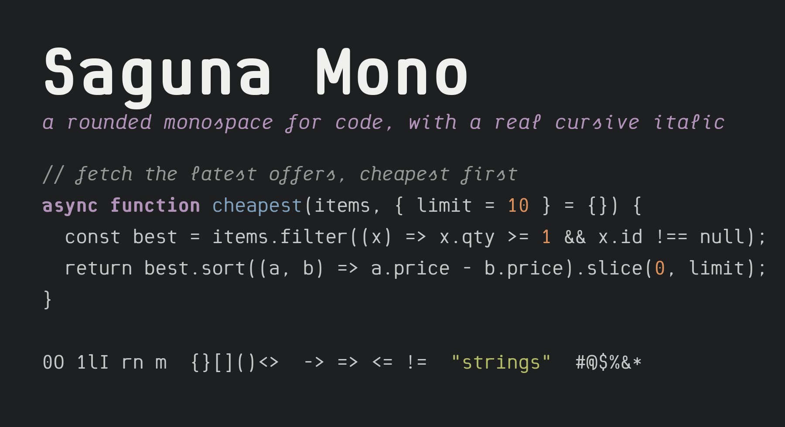
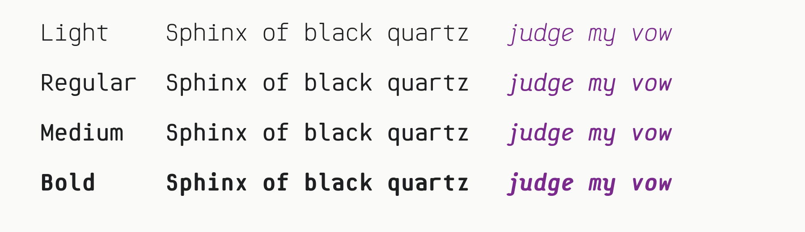
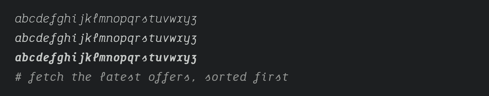
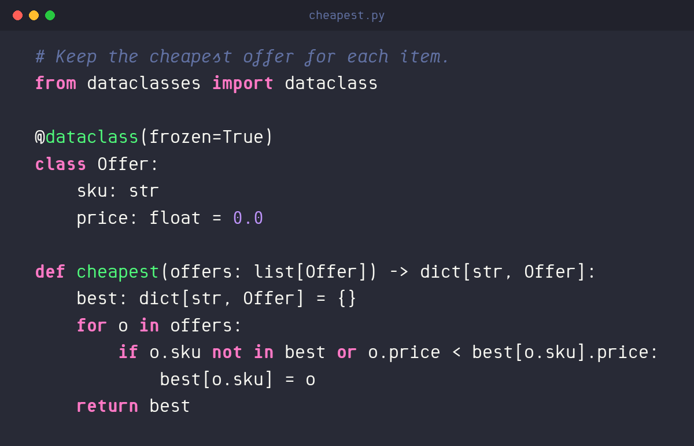
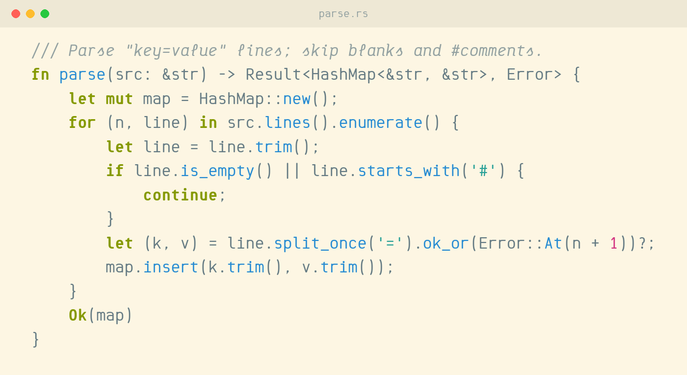
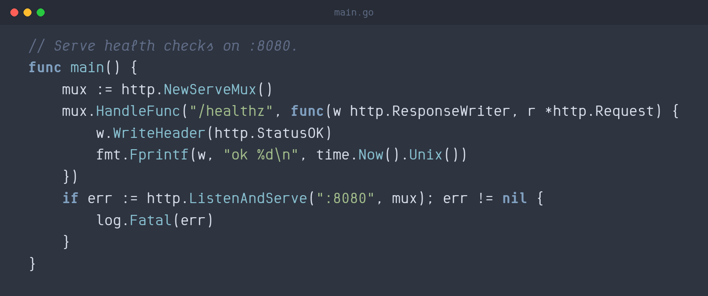
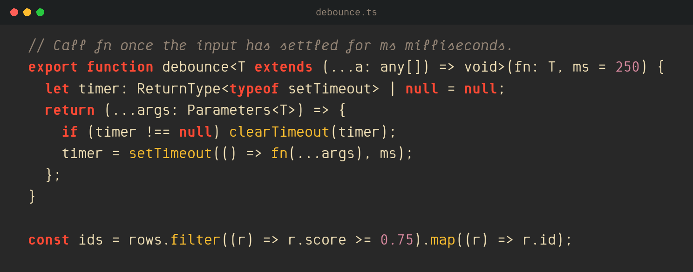
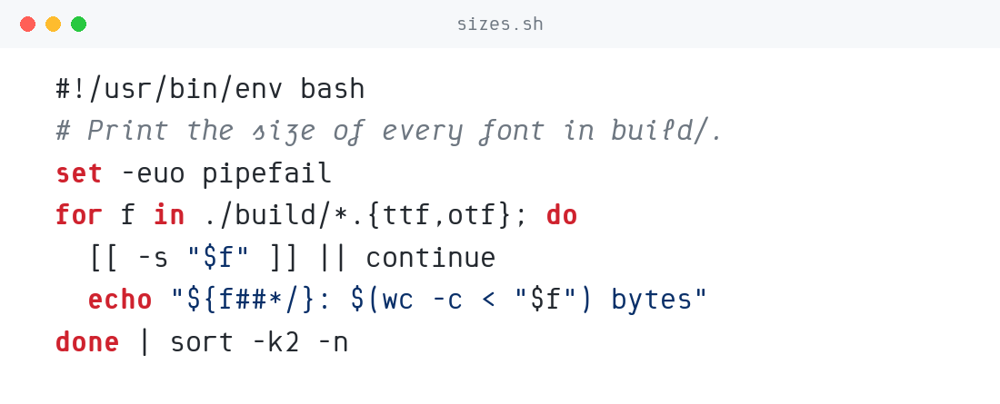

# Saguna Mono

**A rounded monospace for code, with a real cursive italic. Free and open source.**



Saguna Mono is a programming font with a soft, friendly voice. Every stroke ends round, the curves are slightly squarish, and the rhythm is light and open, so long sessions feel calm. Its italic is something different: not a slanted upright, but a proper handwritten cursive. Set your comments in italic and they read like notes in the margin.

## Why Saguna Mono

- **A cursive italic.** Entry and exit strokes, a looped ℓ, an f that loops below the line, a handwritten s and e, ʒ for z, and an r, q and k that flick out.
- **Built for reading code.** 0 has a dot inside, l ends in a tail, 1 has a flag and a foot, and I has bars, so `0O`, `1lI` and `rn`/`m` never blur together.
- **Operators that line up.** `+ - = < > * ->` and `=>` share one maths axis and fill the cell, so they read at a glance. No ligatures needed.
- **Terminal friendly.** Box drawing, block elements, shades and arrows fill the line exactly, so terminal interfaces like htop, tmux and TUI apps join without gaps.
- **Four weights, each with an italic.** Light, Regular, Medium and Bold, plus variable fonts covering every weight from 300 to 700.
- **Every European language.** The full Latin set for European languages, including combining accents.





## Screenshots

**Python** in Dracula



**Rust** in Solarized Light



**Go** in Nord



**TypeScript** in Gruvbox



**Shell** in GitHub Light



## Download

Get the latest release from the [Releases page](https://github.com/partech-systems/font-saguna-mono/releases/latest), or take the files straight from this repo:

| Folder | What's in it |
|---|---|
| [`fonts/ttf/`](fonts/ttf) | the eight static fonts, for desktop apps |
| [`fonts/variable/`](fonts/variable) | `SagunaMono[wght].ttf` and `SagunaMono-Italic[wght].ttf`, every weight in one file |
| [`fonts/webfonts/`](fonts/webfonts) | the variable fonts as WOFF2, for the web |

**macOS and Windows:** double-click each `.ttf` and choose Install.
**Linux:** copy the files to `~/.local/share/fonts` and run `fc-cache -f`.

Install either the static fonts or the variable fonts, not both.

## Use it

**VS Code** (`settings.json`), with italic comments:

```json
"editor.fontFamily": "Saguna Mono",
"editor.fontSize": 14,
"editor.tokenColorCustomizations": {
  "textMateRules": [{ "scope": "comment", "settings": { "fontStyle": "italic" } }]
}
```

**JetBrains IDEs:** Settings → Editor → Font → Saguna Mono.

**Terminals:**

```toml
# Alacritty (alacritty.toml)
[font]
normal = { family = "Saguna Mono" }
size = 14
```

```
# Kitty (kitty.conf)
font_family Saguna Mono

-- WezTerm (wezterm.lua)
config.font = wezterm.font("Saguna Mono")
```

**iTerm2 and Terminal.app:** choose Saguna Mono in the profile's text settings.

**The web:**

```css
@font-face {
  font-family: "Saguna Mono";
  src: url("SagunaMono[wght].woff2") format("woff2-variations");
  font-weight: 300 700;
  font-style: normal;
  font-display: swap;
}
@font-face {
  font-family: "Saguna Mono";
  src: url("SagunaMono-Italic[wght].woff2") format("woff2-variations");
  font-weight: 300 700;
  font-style: italic;
  font-display: swap;
}
code, pre { font-family: "Saguna Mono", ui-monospace, monospace; }
```

## Build from source

The UFO masters and designspaces are in [`sources/`](sources). Build the variable fonts with Google Fonts' toolchain:

```sh
pip install gftools fontmake
gftools builder sources/config.yaml
```

## Licence

Saguna Mono is licensed under the [SIL Open Font License 1.1](OFL.txt). You can use it for anything, including commercial work, apps, websites, logos and printed matter. You can bundle it, embed it, modify it and redistribute it. The one thing you can't do is sell the fonts on their own.

## Credits

Designed by [Partech Systems](https://partechsystems.com/fonts/saguna-mono/). Found a bug or a character that looks wrong? [Open an issue](https://github.com/partech-systems/font-saguna-mono/issues).
